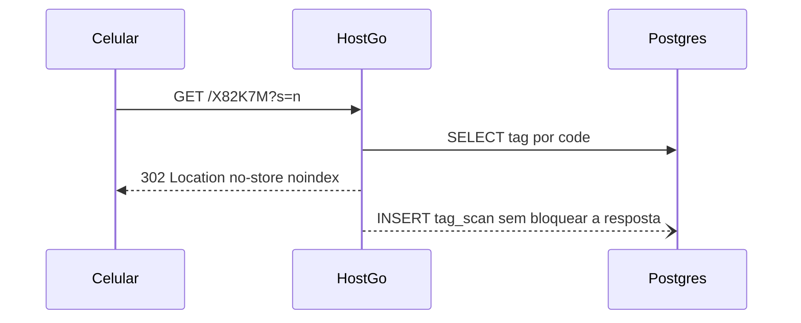

# Plano base: DX Flow Destinos

Arquitetura definida com o [Claude Opus](e2dd84eb-8ea4-4d01-ac99-17f814ec18b2). DX Flow Destinos é um projeto separado, sem relação com o repositório aberto nesta sessão. Nasce do zero em `dxflow-destinos`. A DX Flow permanece dona do código, do banco, do domínio e da infra.

## Veredito

A hipótese Vue 3 + TypeScript + PostgreSQL faz sentido, com um ajuste obrigatório: **não usar SPA pura**. O ativo do produto é ser encontrado no Google (“hotéis em Capão da Canoa”). HTML só no cliente indexa mal.

Decisões fechadas para o MVP:

- **Nuxt na linha estável atual** (Vue 3 + TypeScript), com SSR e API no mesmo processo (Nitro). Nuxt 3 está saindo de manutenção; a API é a mesma da linha estável vigente.
- **Um app, dois hosts:** `dxflow.com.br` (site público + `/admin`) e `go.dxflow.com.br` (só redirect). O host `go.` responde antes do SSR.
- **Um PostgreSQL**, tenancy por linha (`destination_id`). Sem banco ou schema por cidade.
- **RBAC com escopo e sessão real.** Sem usuário/senha fixos no código.
- **Eventos em tabela própria**, fonte da verdade das métricas. Google Analytics não entra no MVP.
- **Infra do piloto:** uma VPS com Docker Compose (app + Postgres + Caddy).
- **Testes unitários com Vitest** (API compatível com Jest, integrado ao Vite do Nuxt). A suíte roda no CI e bloqueia merge se falhar.

Dependências mínimas, a revisar antes de adotar: `nuxt`, `pg`, `zod`, `@node-rs/argon2`, `qrcode`, `vitest`. Sem ORM, sem UI kit. Migrations são arquivos `.sql` numerados. SQL só em repositórios, parametrizado, sem `SELECT *`.

## Modelo de dados

Conteúdo:

- `destinations`: cidade/tenant. `slug` único, `status` (`draft|published`), campos de SEO.
- `categories`: catálogo global da plataforma (`restaurantes`, `hoteis`, `praias`, `parques`, `eventos`, `compras`, `servicos-uteis`, `saude`, `farmacias`, `mecanicas`, `lavanderias`, `telefones-uteis`), com `schema_org_type`. A cidade só lista categorias que tenham itens publicados.
- `places`: agregado único de estabelecimento, atração, serviço e evento. Tipo, slug único por destino, contatos (telefone, WhatsApp, Instagram, URL de avaliação, Maps), endereço, lat/lng, horários, status, SEO. Evento exige `starts_at` e pode apontar para um place-sede. Um agregado só porque página, botões rastreáveis, slug, placa e permissão são os mesmos.
- `place_categories`: N:N, no máximo uma categoria principal (breadcrumb e schema.org).
- `slug_redirects`: slug antigo do place devolve 301. Evita perder indexação ao renomear.

URLs no mesmo nível, como no brief: `/destinos/capao-da-canoa/restaurantes` e `/destinos/capao-da-canoa/acqua-lokos`. A rota resolve categoria, depois place, depois redirect, senão 404. Slug de place não pode colidir com categoria nem com palavras reservadas (`mapa`, `busca`, `sobre`).

Acesso:

- `users`: e-mail único, hash argon2id, `must_change_password`.
- `memberships`: papel + escopo. `platform_admin` sem cidade; `destination_admin` com `destination_id`; `place_editor` com cidade e place. FK composta impede place de outra cidade.
- `sessions`: cookie com hash do token, CSRF, expiração por inatividade.
- `audit_log`: sobretudo troca de alvo de placa, para as métricas fazerem sentido depois.

Placas e métricas:

- `tags`: `code` único e imutável (trigger bloqueia update da coluna). Cidade, place opcional (placa da prefeitura pode não ter place), rótulo (“Recepção”), propósito e alvo mutável (`place_page`, `place_action`, `destination_page`, `category_page`, `external_url`). Ação de place (`whatsapp`, `route`, `phone`, `review`, `instagram`, `website`) é resolvida na hora do scan, lendo o contato atual do place.
- `analytics_events`: append-only. Índices por destino, place e tag em `occurred_at`.

FKs compostas `(destination_id, id)` em places, memberships e tags: uma placa nunca aponta para conteúdo de outra cidade.

## Permissões

- `platform_admin`: destinos, categorias, usuários, tudo.
- `destination_admin`: places, publicação, placas e dashboard da própria cidade; pode criar `place_editor` dessa cidade.
- `place_editor`: edita conteúdo e contatos do próprio place e vê o dashboard dele. Não cria placa nem publica.

Toda leitura/escrita do admin recebe um `AccessScope` e vira `WHERE` parametrizado. Recurso fora do escopo responde 404. O middleware do Vue é só UX; a decisão fica no servidor. Cookie de sessão sem `Domain`, para `go.` nunca recebê-lo. CSRF em mutações. Rate limit no login. Seed do admin lê e-mail do ambiente, gera senha aleatória uma vez no terminal e exige troca. RLS do Postgres fica para a fase SaaS.

## Redirect NFC/QR

- Código de 6 caracteres, alfabeto sem ambiguidades, impresso legível na placa. NFC usa `?s=n`, QR usa `?s=q`. O código é o mesmo.
- **302**, nunca 301: o navegador cachearia o alvo antigo.
- Placa desativada redireciona para a home do destino. Código inexistente: 404 com `noindex`.
- URL externa só `https`, validada na gravação.
- Página interna recebe `?t=CODE` para atribuir o page view à placa; o canonical descarta a query.
- Cache em memória de 60s da tag, invalidado ao editar. Meta de p95 abaixo de 50 ms no servidor.
- Travar a tag NFC depois de gravar. Tag destrancada pode ser reescrita para phishing.

## Analytics

Eventos: `tag_scan`, `page_view`, `click_whatsapp`, `click_route`, `click_phone`, `click_review`, `click_instagram`, `click_website`.

Scan nasce no redirect. Page view e cliques vão por `sendBeacon` para `POST /api/e`; o servidor deriva a cidade a partir do place e não confia no cliente. Links continuam `tel:`, `wa.me` e Google Maps.

Não guardar IP bruto, user-agent completo, geolocalização nem cookie de visitante. Únicos do dia via hash com sal rotativo descartado. Bots de preview (WhatsApp, Facebook, Telegram) marcados e fora do dashboard.

Dashboard do MVP, filtrado pelo escopo: totais 7 e 30 dias, série diária no fuso do destino, ranking de placas e de places, clique/scan, NFC versus QR. Agregação SQL direta. Rollup e partição só quando a tabela crescer.

## SEO

- Páginas públicas em SSR, com cache curto invalidado ao publicar. `/admin` e `/api` com `noindex`. `go.` com `Disallow: /` e `X-Robots-Tag: noindex`.
- Sitemap por destino, só itens `published`. Eventos encerrados há mais de 30 dias saem. Canonical absoluto sem query.
- JSON-LD: `TouristDestination`, `ItemList`, tipo do schema.org da categoria (`Restaurant`, `LodgingBusiness`, `TouristAttraction`, etc.), `Event` e `BreadcrumbList`. Sem `aggregateRating` inventado.
- Place sem descrição ou foto fica `noindex` até estar completo.
- Search Console e envio do sitemap no piloto. Ranking orgânico é médio prazo; a demo depende das placas.

## Testes unitários

Vitest no lugar do Jest. O Nuxt já usa Vite; o Vitest reaproveita o mesmo pipeline de TypeScript, sobe mais rápido e usa a mesma API (`describe`, `it`, `expect`). Jest exigiria transformadores extras sem ganho neste stack.

Escopo do MVP: funções puras e regras de negócio em `server/modules`, com repositório mockado. Sem snapshot de componente e sem teste de ponta a ponta nesta versão. Arquivos `*.test.ts` ao lado do módulo.

O que a suíte cobre, fase a fase:

- Autorização: `authorize` por papel e escopo; recurso de outra cidade não passa.
- Slug: colisão com categoria e com palavra reservada; rename gera `slug_redirects`.
- Placa: alfabeto do código, imutabilidade do contrato (código não entra no update), resolução de alvo (`place_page`, `place_action`, URL externa só `https`), placa desativada cai na home do destino.
- SEO: canonical sem query (`?t=` e `?s=` descartados); place sem descrição ou foto sai com `noindex`; JSON-LD não emite `aggregateRating`.
- Analytics: classificação de bot de preview; hash diário não devolve IP nem user-agent; tipos de evento aceitos pelo schema do beacon.

CI (fundação): `vitest run` junto com lint e typecheck. Cada fase só fecha com os testes daquela regra verdes.

## Fora do MVP

Mapas interativos (só o botão “Como chegar”), app nativo, billing SaaS, domínio próprio por cidade, moderação de edições, multi-idioma, avaliações próprias, busca full-text, eventos recorrentes, 2FA, exportação e relatórios por e-mail. O modelo já aceita várias memberships; a UI do MVP usa um seletor simples.

## Fases

Estimativa de referência: cerca de 5 semanas para 1 dev em tempo integral.

1. Fundação: repo Nuxt strict, Vitest com um teste de fumaça, Compose, migrations, HTTPS nos dois hosts, CI (lint, typecheck, `vitest run`), backup `pg_dump`.
2. Auth e RBAC: login, sessão, CSRF, seed do admin, testes unitários de `authorize` e de escopo entre cidades.
3. Conteúdo: Capão da Canoa com categorias e CRUD de places/eventos, com testes de slug e redirect 301. Meta: 30 a 60 fichas reais.
4. Site público: as três rotas, meta, JSON-LD, sitemap, privacidade, com testes de canonical e `noindex`.
5. Placas: geração de código e QR, host `go.`, beacon e troca de alvo sem reimprimir, com testes de resolução de alvo e do beacon.
6. Dashboard e piloto físico: QR impresso, NFC travada, teste em iPhone e Android em 4G, demo para um hotel ou parque.

## Riscos

- `go.dxflow.com.br` fora do ar derruba todas as placas. Monitor, certificado automático e restore testado.
- NFC sem lock e QR coberto por adesivo falso. Travar a tag e imprimir o código legível.
- Código impresso errado não se reaproveita. Gerar o lote, testar cada placa, não reutilizar código.
- Página fina não ranqueia. A demo não depende do Google.
- Um `WHERE` esquecido vaza outra cidade. Escopo obrigatório no repositório, FK composta e teste de 404 por endpoint.
